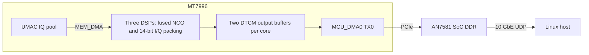

# DSP NCO and packed IQ output on XR1710G

The optional DSP NCO path rotates received IQ on the three MT7996 DSPs,
packs the result to 28 bits per complex sample and sends it through the
existing PCIe and 10 GbE path. It supports **40 and 80 MS/s** and is **off by
default**. Frequency changes are online and phase continuous; they do not flush
samples or restart reception. Switching the path itself requires stopping the
stream. Higher sample rates use the existing receiver path with DSP NCO disabled.

## Using the optional path

Run these commands on the Linux host, from this repository. Build the current
RAM firmware first and select the unit's normal configuration:

```sh
make -C firmware
export W1700K_CONFIG=/path/to/config.json
host/bin/w1700k stop
host/bin/w1700k band 1 --rate 80
host/bin/w1700k start --dsp-nco
host/bin/w1700k nco 1000
host/bin/w1700k nco -2500
host/bin/w1700k nco 0
```

`nco` accepts Hz. A positive value moves received baseband frequencies upward.
Its reply includes the applied frequency, stream-run token, first affected
sample index and phase at that sample. The phase accumulator advances across
2048-sample blocks and all three cores; updating the frequency changes its step,
not its current phase. A zero setting keeps the DSP path running with zero
additional frequency shift. To bypass the DSP path:

```sh
host/bin/w1700k stop
host/bin/w1700k start --no-dsp-nco
```

For a configuration default, add:

```json
"dsp_nco": {"enabled": true, "frequency_hz": 0.0}
```

The command-line switches override `enabled` for that start. Each new stream
uses the configured initial frequency and starts its own phase timeline.
The JSON controller accepts `{"op":"start","dsp_nco":true}` and
`{"op":"nco","hz":1000}`. Enabling the path for the first time loads the
optional DSP image into RAM; all four images are checked against `firmware.json`.
No flash update is needed. Output uses the existing packed-IQ UDP format and
works with the host stream decoder.

### Existing UE frequency-correction interface

The existing OpenISAC XR1710G backend can use this path through its ordered
helper interface. Start reception with DSP NCO enabled at zero frequency, and
set the existing `xr1710g_pll_command` option to:

```text
env PYTHONPATH=/path/to/xr1710g-sdr/host python3 -m w1700k.dsp_nco --config /path/to/config.json --backend
```

The option retains its existing name; this helper performs digital rotation.
It implements `OPEN`, `SET` and `CLOSE`, reports the actual frequency grid,
and reverses the sign of an LO correction when applying it to baseband. The
UE's existing estimate-age and ordered-command handling remains in use.
The helper rejects old request IDs, changed streams, band/rate/LO changes and
conflicting frequency updates. Firmware additionally checks the stream-run
token and a 500 ms command deadline before applying a request. Closing the
helper restores zero shift only if it still owns the same stream and setting.
Use one frequency controller at a time; stop the UE before issuing manual
`nco` commands. Changing the sampling clock is a separate operation.

## Data path



MCU_DMA0 reads the packed output directly from each DSP's DTCM, avoiding a
return copy to the UMAC pool. Each core processes 2048 complex samples per job:
8192 input bytes become 7168 packed output bytes. Each core has two input and
two output buffers. Input DMA, computation and PCIe output can overlap;
a buffer remains owned by PCIe until the DMA completion index advances.
The scheduler submits output in sample order even if cores finish out of order.
The continuous producer uses one outstanding MEM_DMA input transfer, 128
immutable pool-source descriptors and six immutable DTCM-destination descriptors.
The two rings advance independently, preserving the 128-block ICAP wrap and the
six-buffer DSP cycle without changing addresses under descriptor prefetch.
ICAP completion gates input reads; overrun detection stops the stream before an
unread input block can be overwritten. Stop requests drain assigned jobs and
PCIe output before releasing the capture route.

## Bounded synthetic benchmark

All rates below count complex samples and use decimal units. DSP arithmetic
uses the 640 MHz DSP cycle counter; complete processing uses the 720 MHz WM
cycle counter, from the GO trigger through the last PCIe completion. Initialization, reference generation and SSH transfer are excluded.

| Test | Original C | Separate assembly NCO and packing | Fused kernel and overlapping DMA |
| --- | ---: | ---: | ---: |
| One DSP, NCO only | 20.64 MS/s | 39.64 MS/s | Unchanged separate kernel |
| One DSP, NCO and packing | 18.99 MS/s | 33.98 MS/s | **42.96 MS/s** |
| One DSP, complete processing | 15.39 MS/s | 23.95 MS/s | **41.63 MS/s** |
| Two DSPs, complete processing | 30.78 MS/s | 47.91 MS/s | **83.23 MS/s** |
| Three DSPs, complete processing | 46.17–46.20 MS/s | 71.8–71.9 MS/s | **122.1–123.6 MS/s** |

Complete processing includes input DMA, NCO, packing and PCIe output. The first
two versions use the same blocking DMA scheduler; the final column uses double
buffers and a scheduler that polls transfer and computation completion without
waiting for each stage in sequence. Packing alone measured approximately
238 MS/s per core. The separate immutable-buffer DTCM-to-SoC-DDR test measured
714.55 MB/s per source, with all three DSPs tested separately.

The final-image 10 GbE checks received every packet on the Linux host:

| Input | Packets | Complex samples | Result |
| --- | ---: | ---: | --- |
| Positive, negative and zero frequency offsets, three runs | 49,152 | 100,663,296 | 122.3–122.5 MS/s |
| Random complex IQ | 4,096 | 8,388,608 | 123.55 MS/s |
| Full-scale corners with frequent saturation | 4,096 | 8,388,608 | 81.63 MS/s |
| Longer zero-offset run | 65,536 | 134,217,728 | 123.35 MS/s over 1.088 s |

Together these cover 251,658,240 complex samples and 840 MiB of packed payload.
Sequence numbers were contiguous and every payload byte matched an independent
integer reference. The clipping case counted exactly 8,384,908 saturated
components, matching the reference. Both DMA engines reported zero error status;
the exporter reported no unsent packets. DSP faults, WM traps and buffer-guard
corruption were absent. These are bounded measurements using a repeated known
input block, not sustained RF-stream acceptance or DSP hardware limits. Six
additional short runs covered one through three cores, minimum job counts and
consecutive invocations without clearing the previous DSP acknowledgement.
Every request sequence advanced by the number of jobs assigned to its core.

## NCO precision and continuity

The [separate assembly kernel](../firmware/dsp/nco_q15.S) uses two custom MAC
accumulators, rounded result readout, and signed saturation. A 16-sample
unroll interleaves preparation of the next input and coefficients with the
current sample's MAC operations. Ordinary inputs avoid the saturation path;
overflowing components still clamp and increment the clipping count.

The [fused kernel](../firmware/dsp/nco_pack_q15.S) retains these numerical rules.
It computes sample 7 of each eight-sample group first, then samples 0 through 6,
so the bits stored in their spare positions are available before each output
store. Phase indices follow the corresponding sample indices, preserving the
same result across phase wrap and block boundaries. It also combines the two
component range checks into an unsigned comparison before entering the clipping
path. This removes operations from the ordinary path while preserving clipping
and its count. The fused kernel needs **14.8975 cycles per complex sample**
including packing, compared with approximately 18.84 for the separate stages.

Standard RISC-V Vector instructions are not available in the tested
configuration: `misa.V` is clear, and `vsetvli` and `vlenb` access raised illegal
instruction exceptions on all three cores after attempting to enable vector
state. The known 128-bit register-group loads/stores do not by themselves
demonstrate vector arithmetic support.

The earlier separate assembly kernel reduced the NCO cost from 31.010 to 16.146 cycles per
complex sample. Thirty-three additional cases compared output words, clipping
counts and final phase exactly against an independent integer reference on
all three cores. They cover full-range inputs, clipping, phase wrap, positive
and negative steps, and blocks from 16 to 2048 samples. Numerical behavior
matches the original kernel. The throughput table uses unclipped inputs;
deliberately saturating one component of every sample measured 24.77 MS/s per
core including packing. The final fused image passed **66 cases** across both
buffer banks on all three cores, including exact packed output, clipping counts,
final phase, unchanged input and output guards. Its deliberately saturated
local benchmark reached **27.95 MS/s per core** including packing. Throughput
therefore depends on how often the rotated signal clips; the 123 MS/s result
must not be treated as a guarantee for full-scale inputs.

The NCO uses a 32-bit phase accumulator and a 4096-entry sine/cosine
table with Q15 coefficients. For sample rate `Fs` and frequency shift `f`,
`step = round(f / Fs * 2^32)`. The accumulator advances modulo `2^32`.
At 40 MS/s the frequency step is approximately 0.00931 Hz; coefficient lookup
still has its own phase quantization.

Each block starts at the phase belonging to its absolute sample offset.
Consequently, distributing consecutive blocks across three cores preserves
phase continuity. A separate single-core test also verified that a 2048-sample
job equals two consecutive 1024-sample jobs exactly.

Tests on all three cores covered zero, positive, negative and near-Nyquist
frequency shifts, plus intentional clipping. The non-clipping random-input
cases at +25 kHz and -1.25 MHz, referenced to 80 MS/s, gave approximately
-66.8 dB and -69.6 dB EVM against ideal floating-point rotation. Those frequency
parameters do not imply an 80 MS/s throughput test.

Rotation is followed by rounding and saturation to signed 14-bit I/Q. A sample
whose magnitude exceeds the output range can clip after rotation even when
both original components fit. Packing is lossless relative to this quantized
output; the NCO operation itself is not lossless.

## Continuous reception and limits

The receive path is implemented in
[`dsp_producer.c`](../firmware/stream/dsp_producer.c), with host control in
[`dsp_nco.py`](../host/w1700k/dsp_nco.py). It does not start the WA packer.
Commands apply before assigning the next input block. The acknowledgement
records the precise sample boundary and the phase already accumulated there.
Queued earlier samples remain in order and are delivered normally.

The final 2026-10-17 firmware sustained 80 MS/s for 30.221 seconds: all
1,180,509 packets (8,461,888,512 packed payload bytes) arrived in sequence,
with zero lapped buffers, malformed packets or unsent exports.

On hardware, 40 and 80 MS/s reception passed continuous packet-sequence checks,
online positive/negative/zero frequency changes and normal stop/restart. Each
DSP run also compared its last 16,384 RF-acquired samples exactly against an
independent Q15 reference using the frozen ICAP input pool. Switching to bypass
and back passed without reloading the firmware. These checks validate the data
path and numerical correction; they do not establish OFDM EVM or link performance.

The synthetic fused benchmark reaches roughly 123 MS/s with ordinary inputs,
but frequent full-scale clipping reduces it to 81.63 MS/s. Therefore 80 MS/s
has little margin for persistent saturation. Reduce receiver gain if the rotated
signal clips heavily. A pipeline fault or input overrun stops reception and
requires a firmware reload before another DSP start; the controller marks the
firmware for reload automatically. There is no silent fallback or sample skipping.
160/320 MS/s DSP operation is rejected before starting reception.

A digital NCO changes carrier frequency without changing sample timing. It
does not correct sampling-clock error by itself. See
[PLL fine tuning](pll-fine-tune.md) and [crystal trim](xtal-trim.md) for separate
hardware controls.

## Reproducing the build

The fused kernel, DSP mailbox firmware and overlapping WM scheduler are retained
under [`firmware/dsp/`](../firmware/dsp/README.md). The standalone build needs
Python 3, clang, ld.lld and llvm-objcopy:

```sh
python3 firmware/dsp/probe/build.py --output runtime/dsp-nco-build
```

This produces the DSP RAM container, WM probe, ELF files and a manifest with
source and image hashes. It does not deploy or flash them. The final tested
DSP container SHA256 is
`3cea64fc3688f54b05e0f772ce4841cec5f444de8f8387d4b284216163118b59`;
the standalone WM probe SHA256 is
`4638a77bce60d5019c94d1a355ee3efeb3c77241d712e7ab5d7db9f29dbbd8e5`.

The probe was loaded into RAM and the wireless subsystem was reset after each
test. It did not write flash or enable RF transmission. Detailed scripts and
measurements are retained locally in the ignored directory
`runtime/dsp-nco-20261016/`, `runtime/dsp-nco-opt-20261016/` and
`runtime/dsp-nco-fused-20261016/`. Continuous receive checks are retained in
`runtime/dsp-path-20261017/`.
