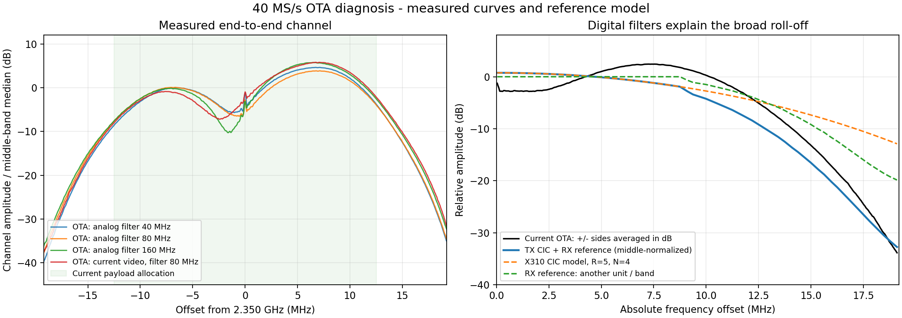

# Edge roll-off in the X310 to XR1710G link

On 2026-10-15, passive channel captures and a source review identified two
substantial contributors: X310 interpolation droop at 40 Msps, and the XR
receiver's rate-dependent filtering. Their combined response explains the
scale and broad shape of the measured edge attenuation. The present data do
not independently measure each device's transfer function.

The investigation kept the live video and sensing services running. It did
not change radio rates, gains, analog filtering, payload allocation or UE
equalization. A new eight-second capture collected 154 channel estimates and
153 constellation frames.



## X310: an odd interpolation factor bypasses the halfbands

The live configuration uses a 200 MHz master clock and 40 Msps input, hence
interpolation by five. Its startup log explicitly warns of passband CIC
roll-off. In the [UHD 4.10 DUC controller](https://github.com/EttusResearch/uhd/blob/v4.10.0.0/host/lib/rfnoc/duc_block_control.cpp),
`set_interp()` enables halfband stages only for factors of two. Five therefore
selects zero halfbands and a CIC factor of five. The
[RFNoC DUC RTL](https://github.com/EttusResearch/uhd/blob/v4.10.0.0/fpga/usrp3/lib/rfnoc/duc.v)
instantiates four CIC sections.

For that standard chain, the normalized amplitude is

```text
A_TX(f) = |sinc(f / 40 MHz) / sinc(f / 200 MHz)|^4
sinc(x) = sin(pi*x) / (pi*x)
```

This is a theoretical response derived from the source and configured rates,
not an RF measurement of the installed FPGA image. At +/-17.5 MHz, it already
predicts 11.3 dB attenuation relative to DC.

The daughterboard is UBX-160 v2. Its
[UHD driver](https://github.com/EttusResearch/uhd/blob/v4.10.0.0/host/lib/usrp/dboard/db_ubx.cpp)
sets the analog bandwidth range to the single 160 MHz value; a YAML request
for 40 MHz does not turn this board into a programmable 40 MHz analog filter.
This observation comes from the driver and previously identified board, not
a second USRP session opened against the running transmitter.

## XR: substantial receive-path roll-off remains with a wide analog filter

The prior fixed-rate OTA comparison changed the XR analog filter from 40 to
80 to 160 MHz. The broad edge/middle statistic improved from -25.68 to -24.70
to -23.32 dB: about 2.36 dB across the entire change. Simply widening that
filter did not remove the attenuation. Those successive OTA captures include
propagation changes and are not a calibrated analog-filter sweep.

The repository's [40 Msps correction table](../host/stream/src/flatten.cpp)
records an RX response of approximately -4.4, -9.2, -16.0 and -19.7 dB at
12.5, 15, 17.5 and 19 MHz offset. It was measured on **unit A, band 1
(MT7977), analog filter 40 MHz**, from the receiver noise floor. The live
XR1710G uses **band 0 and an 80 MHz analog filter**. This is an RX-path
reference, including its original analog setting, not an isolated digital
filter measurement or a calibration of this unit.

| Absolute offset | X310 CIC model, relative to DC | RX reference | Combined model, middle-normalized | Current OTA, middle-normalized |
| --- | ---: | ---: | ---: | ---: |
| 12.5 MHz | -5.5 dB | -4.4 dB | -9.2 dB | -5.1 dB |
| 15.0 MHz | -8.1 dB | -9.2 dB | -16.6 dB | -13.2 dB |
| 17.5 MHz | -11.3 dB | -16.0 dB | -26.5 dB | -24.4 dB |
| 19.0 MHz | -13.5 dB | -19.7 dB | -32.4 dB | -33.7 dB |

The current OTA column takes the median over frames of per-frame normalized
channel amplitude in dB, then the median across +/-250 kHz windows around
both frequency offsets. The middle reference is FFT bins `40 <= |k| <= 200`
(1.56 to 7.81 MHz). The combined model uses the same middle reference; the
individual TX column uses DC. These narrow windows differ from the earlier
broad edge statistic over bins 400-489. The plot's right-hand measured curve
averages the positive and negative sides in dB.

The observed asymmetry and central dip are additional end-to-end effects;
these captures do not isolate antenna response, multipath, receiver DC
processing or channel-estimation bias. Model agreement supports the filter
explanation but does not assign an exact measured loss to either radio.

## Why weak carriers form spokes in the constellation

The active UE uses MMSE equalization. The deployed source matches the local
`UHD_OFDM` checkout for `src/UE.cpp` and `include/OFDMCore.hpp`. The latter's
`compute_mmse_inverse()` implements:

```text
W[k] = conj(H[k]) / (|H[k]|^2 + noise_var)
W[k] * H[k] = |H[k]|^2 / (|H[k]|^2 + noise_var)
```

Away from the magnitude floor, weak channel coefficients therefore give an
output radius below one, even for an otherwise ideal input constellation.
This explains contraction toward the origin; it is downstream of the
attenuation already visible in the channel estimate.

The UE estimates one noise regularization value from pilot residuals and
uses it across subcarriers. RX filtering colors both signal and upstream
noise, so a single noise value can over-regularize attenuated edge carriers.
This is a source-based mechanism worth testing, not a measured diagnosis of
the noise PSD. Receive-filter attenuation alone does not necessarily reduce
SNR by the same dB value. X310 transmit droop, later noise and quantization
can still reduce the effective edge SNR. A rounder ZF constellation by itself
would not prove lower packet error rate.

The stream's optional flattening is currently off. Its implementation also
requires `radio_filter_hz == radio_sample_rate`, so 80 MHz analog filtering
with 40 Msps IQ makes it unavailable. Its existing coefficients come from
the different unit/band described above; enabling them would amplify noise
along with samples and would not remove X310 transmit droop.

## Follow-up options

- TX: test bounded per-subcarrier CIC pre-emphasis before the OFDM IFFT.
  Coefficients are static at a fixed rate, but gain normalization, DAC
  headroom and PA clipping must be checked. Compensation can flatten the
  relative response without recovering free transmit power.
- RX: test capture at 80 Msps followed by a properly filtered host
  decimation to 40 Msps. This moves the wanted +/-20 MHz region away from
  the XR 80 Msps filter edge; it does not correct the X310's existing CIC
  response. This backend path has not been implemented or RF validated.
- Equalizer: evaluate per-subcarrier noise regularization if a future DSP
  change is desired. Validate decoded payloads rather than constellation
  appearance alone.

Exact causal separation needs a fixed-tone or known-spectrum comparison
that changes one conversion chain at a time. The current 25 MHz payload
allocation and working video link were retained during this diagnosis.

Evidence and the reproducible plotting script are in
`runtime/rolloff-diagnosis-20261015/`; input channel captures are in
`runtime/filter-bandwidth-20261015/`. Runtime artifacts are ignored by Git.

## Master-clock comparison

A subsequent [hardware experiment](x310-160mhz.md) changed the X310 master
clock from 200 to 160 MHz while retaining 40 Msps OFDM and the XR's 80 MHz
analog filter. The broad edge/middle channel-amplitude statistic improved
from **-31.77 to -23.58 dB**, about **8.2 dB**, in successive short captures.
The change replaces the factor-five CIC interpolation with a factor-four
halfband path. This supports the TX droop diagnosis, while the remaining
attenuation and the uncontrolled OTA channel prevent exact component attribution.
The baseline differs from the earlier table because it was acquired later.

The later 80/160 Msps captures use different absolute frequency offsets for
the same FFT bins. Their normalized edge statistics must not be compared as
if they measured a fixed-frequency filter response.
