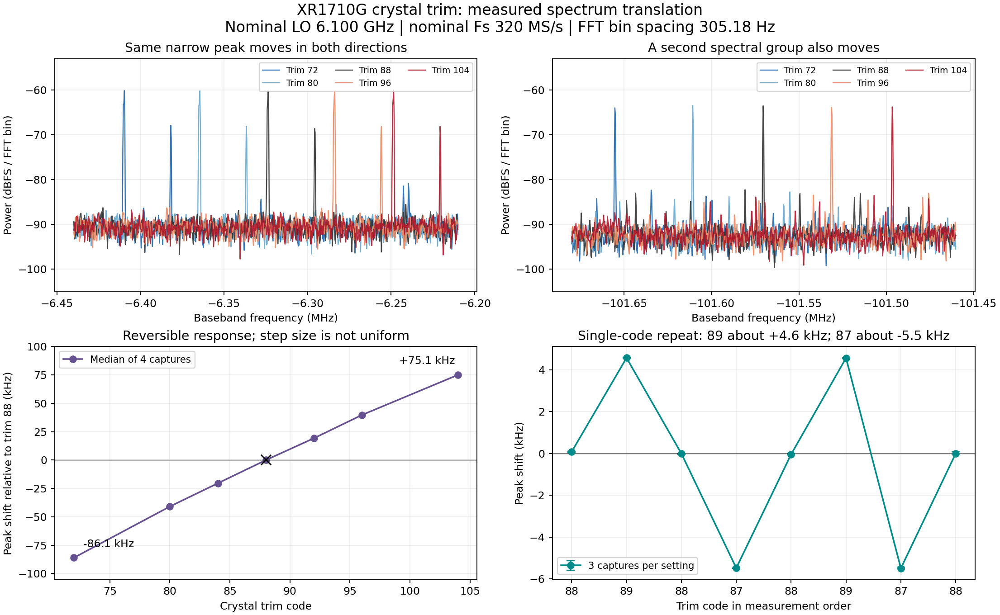

# Crystal trim experiment

The crystal reference can be controlled through A-die 2 TOP registers `0x654`
and `0x658`, bits `[30:24]`, when `0x700056f0[18]` is clear. Both fields receive
the same 7-bit code. This is separate from `w1700k trim`, which changes the
analog filter RC trim. These volatile register writes do not modify EEPROM.

On the XR1710G tested on 2026-10-15, both words initially read `0x58402a2a`
(code **88**). Bounded tests of codes 87, 88 and 89 during a live 320 MS/s
capture passed write/readback checks, kept all three synthesizers locked and
left the WM trap count at zero. The two original words were restored exactly.
The source frontier advanced throughout the valid experiment and its lost
counter did not increase during the ten measurement windows.

Run the helper on the Linux receiver host, from this repository, with sole RF
control access. Read the current code without changing it:

```bash
python3 tools/xtal_trim_probe.py --config /path/to/config.json
```

Try the adjacent code for two seconds and restore the saved values:

```bash
python3 tools/xtal_trim_probe.py --config /path/to/config.json --step 1 --seconds 2
```

`--step -1` tests the other adjacent code. The helper checks the WM version,
crystal strap, paired codes, readback and lock status. It restores the saved
trim fields on normal completion, a Python exception, SIGINT or SIGTERM, using
a fresh control channel. The final JSON record must report `phase: restored`
and the original code. Power loss, SIGKILL or loss of device connectivity can
prevent software restoration. Only this helper's control channel is closed;
the shared SSH master is preserved.

The first adjacent-code test established register control. The expanded spectral
experiment below establishes reproducible relative frequency movement as well.
The input lines have not been identified or calibrated against a frequency
standard. Before enabling UE automatic trim, characterize settling, temperature
drift, quantization and usable range on the target band and sample-rate setup.
CFO can contain transmitter error and Doppler as well as receiver clock error;
use independent timing/SFO evidence when separating these effects matters.

Crystal trim steers a shared reference and is not an independent digital NCO.
For finer carrier correction, see the [PLL fine-tuning experiment](pll-fine-tune.md):
direct frequency-word updates produced approximately 100 Hz steps on this XR1710G.
An eventual control loop needs calibrated polarity, a deadband larger than the
quantization/noise, bounded steps, settling intervals, loss-of-lock hold, and
one owner of the radio control mailbox. The current helper is a bounded
experiment; it does not enable that loop.

TOAE was also checked: bypass, TAU and manual mode bits accepted writes, but
no completion state or identifiable frequency translation appeared in the
current ICAP path. The register map identifies H-peak, tau and FFT/channel
estimate processing. It is not a validated sample-stream frequency shifter.
Raw experiment captures are in the ignored `runtime/frequency-control-20261015/`
directory; OpenISAC's investigation note records the SIMD comparison separately.


## Expanded spectrum test

The 2026-10-15 follow-up held the nominal LO at 6.100 GHz and nominal rate at
320 MS/s. It swept `88, 92, 96, 104, 88, 84, 80, 72, 88`, with four independent
IQ snapshots per setting. Each snapshot contained 2,097,152 consecutive IQ
samples, with every slice tag checked before and after copying. Averaging two
1,048,576-point Hann-window FFTs gave 305.18 Hz bin spacing; log-power parabolic
peak interpolation was used for relative peak tracking. No software frequency
shift was applied to these captures.



The strongest incidental narrow line moved as follows (median of four captures,
relative to the first trim-88 setting):

| Trim | Observed baseband peak, MHz | Relative shift, kHz |
| --- | ---: | ---: |
| 72 | -6.409668 | -86.050 |
| 80 | -6.364509 | -40.891 |
| 84 | -6.344013 | -20.394 |
| 88 | -6.323618 | 0 |
| 92 | -6.304368 | +19.251 |
| 96 | -6.283889 | +39.729 |
| 104 | -6.248560 | +75.058 |

Both returns to 88 were within 0.03 kHz of the initial median. A second spectral
group near -101.57 MHz moved in the same direction (about -84.8/+73.9 kHz at
72/104). Thus the observed movement is reproducible across multiple features.
The sign is: **increasing the trim code moves these received peaks toward
positive baseband frequency**.

A separate `88,89,88,87,88,89,87,88` sequence, three captures per setting,
resolved the previously unobserved single-code changes: 88→89 was about
+4.57 kHz, while 88→87 was about -5.48 kHz. The two repeats agreed within
0.02 kHz at each offset code. Trim is coarse and nonlinear; a single universal
Hz/code coefficient would lose this detail. This measured behavior favors trim
for slow reference-clock correction, with a separate fine carrier actuator if
small residual CFO must also be removed.

The line-spacing changes are consistent with a common LO/sample-clock change,
but converting them to ppm assumes stable absolute RF features. Under that
model, the strongest line's movement corresponds to approximately -12.3 ppm at
104 and +14.1 ppm at 72 relative to 88. These are model-based relative estimates,
not an absolute oscillator calibration.

PLL locks remained asserted and WM traps remained zero. The source had
intermittent lost completions during parts of this follow-up; only tag-validated,
contiguous windows were used for the spectra. Stream continuity is therefore
not established by these results. The two original trim words were restored to
`0x58402a2a` after each experiment.

Raw IQ is retained on the Linux receiver host in the `xr1710g-xtal-spectrum-20261015`
and `xr1710g-xtal-spectrum-fine-20261015` experiment directories. The ignored
local `runtime/xtal-spectrum-20261015/` directory contains the sweep script,
spectral arrays, analysis, figures and restoration records. The bounded public
helper above still defaults to a one-code trial.


## Source-count rate cross-check

A further `88→104→88→72→88` sequence measured the source completion frontier
for 30 seconds per setting, sampled every 5 ms against the Linux receiver host's
`CLOCK_MONOTONIC_RAW`. Events were subtracted; no source-lost increments or run
changes occurred in these five windows. The fitted nominal-sample rates were:

| Trim, in measurement order | Samples/s from sequence rate |
| --- | ---: |
| 88 | 319,992,356 |
| 104 | 319,988,177 |
| 88 | 319,992,772 |
| 72 | 319,996,828 |
| 88 | 319,992,781 |

Relative to the mean of the bracketing trim-88 windows, 104 decreased the rate
by about **13.7 ppm**, and 72 increased it by about **12.7 ppm**. This independently
supports the shared-clock interpretation and the direction inferred from the
spectra. Delivery batching/jitter and the uncalibrated host clock limit this
method; it measures completion rate, not a direct ADC clock pin. The nominal
rate offset in the table is not an absolute oscillator-error calibration.
The fitted residuals were about 85k–93k samples; formal OLS errors do not account
for correlated transport delay. Do not treat the difference from the spectral
ppm estimate as a precise calibration residual.

The final setting was again restored to 88, all three PLLs locked, traps zero.
Raw timestamp/frontier points and results are retained in
`runtime/xtal-spectrum-20261015/rate/` (remote `xr1710g-xtal-rate-20261015/`).
